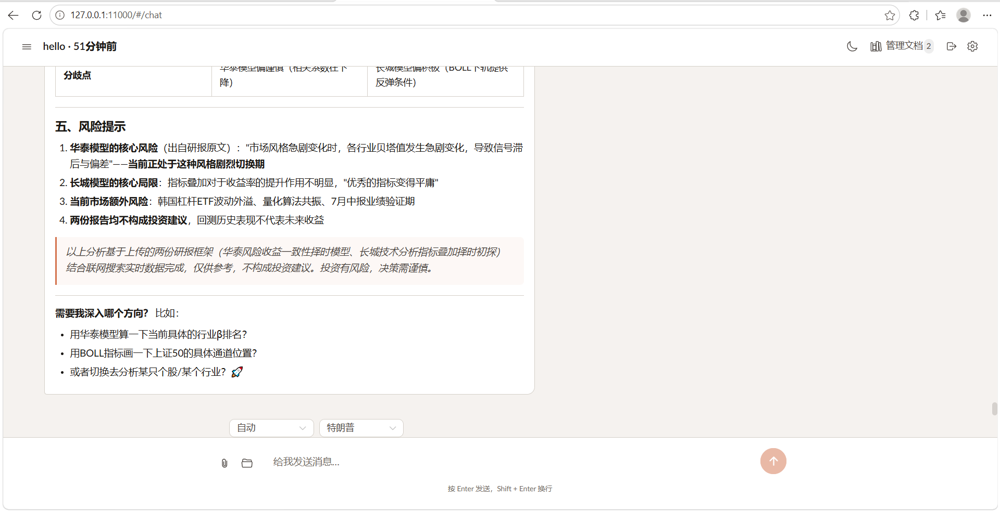
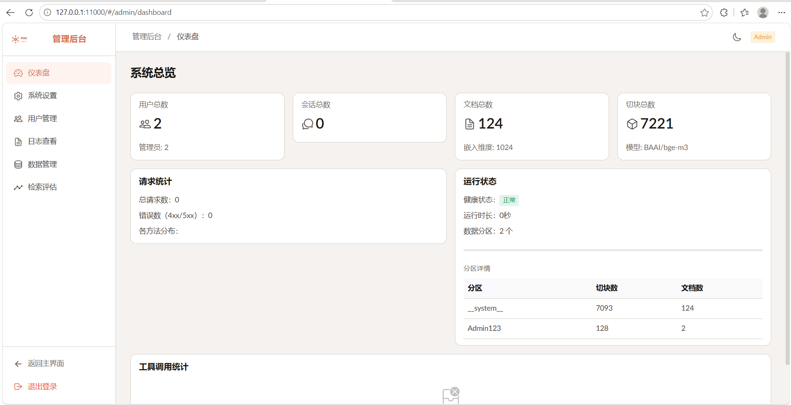

# AskFlow

> 面向多源异构知识（PDF／网页／图片）分散、检索低效的痛点，构建统一接入、支持自然语言问答的 RAG 知识系统。

基于 **FastAPI + Vue 3** 的前后端分离架构，采用**端口/适配器（六边形）**分层，内置可中断续跑的 Agent 工具循环、向量检索与 RRF 融合、MinerU PDF 解析，并能生成 PDF 交付物。

[]()
[]()
[]()
[]()
[]()
[]()

---

## 简介

AskFlow 把散落在 PDF、网页、图片中的知识统一接入，通过 **RAG + Agent 工具调用**完成检索、推理与答案生成，适合内部知识库问答、资料综述与报告产出等场景。

- **Agent 驱动**：LangGraph 状态机编排的工具调用循环，可按需检索知识库、联网搜索、读取文档、生成交付物。
- **多模态检索**：文本与图片在同一向量空间检索，多路结果按 RRF（倒数排名融合）重排。
- **可替换后端**：存储、向量库、对象存储、缓存均通过开关切换本地实现或 Docker 服务，业务代码无感知。
- **面向生产**：JWT 鉴权、管理后台、上下文治理、断点续跑、Docker 容器化部署。

## 技术栈

| 层 | 技术 |
|---|---|
| 后端 | Python 3.11 · FastAPI · LangGraph · SQLAlchemy · Uvicorn |
| 前端 | Vue 3 · Vite · Pinia · vue-router · naive-ui |
| 检索 | Milvus · RRF 融合 · Chinese-CLIP（图文向量） |
| 文档 | MinerU（PDF 结构化解析）· PyMuPDF |
| 基础设施 | MySQL / SQLite · Redis · MinIO · SearXNG · Docker Compose |
| 鉴权 | JWT（短时效 access + 轮换 refresh，httpOnly cookie） |

---

## 快速开始

### 前置条件

- Python 3.11+
- Node.js `^20.19` 或 `>=22.12`
- LLM API Key（对话 + 嵌入）
- Docker（可选；启用本地 MinerU / 其它基础设施时需要）

### 1. 安装后端

```bash
cd backend
# 使用 uv（推荐）
uv sync

# 或 pip（从 pyproject.toml 安装）
pip install -e .
```

### 2. 配置

配置以环境变量为主（12-factor）：在 `backend/` 下复制 `.env.default` 为 `.env` 后填入必要配置，
也可通过系统环境变量或 `docker compose` 注入覆盖。

```bash
cd backend
# 首次部署：复制默认基线并填入配置
cp .env.default .env

# 最小配置需要：
#   LLM_API_KEY / LLM_BASE_URL / LLM_MODEL
#   EMBED_API_KEY / EMBED_BASE_URL / EMBED_MODEL
#
# PDF 解析默认走本地 MinerU（docker compose 启动，无鉴权，无需 API Key）
#
# 完整配置项参见 .env.default（各段均有注释）
```

参见 [backend/.env.default](backend/.env.default) 各段注释。

### 3. 启动后端

```bash
cd backend
python app.py
# 服务启动于 http://0.0.0.0:11000
```

> **可选**：基础设施与后端支持 Docker 化部署（见「Docker 部署」）。
> 默认不依赖任何容器；`.env` 中的开关按需切换。

### 4. 构建前端（可选，也可使用开发模式）

```bash
cd frontend
npm install
npm run build        # 生产构建 → frontend/dist/
# 或 npm run dev     # 开发模式 localhost:5173
```

构建后的 `frontend/dist/` 会自动被 FastAPI 作为静态文件服务。

### 5. 访问

- **对话界面**：`http://localhost:11000` —— 普通用户登录后进入
- **管理后台**：`http://localhost:11000/#/admin` —— 管理员登录后进入
  - 管理员账号由 `.env` 的 `AUTH_SUPERUSER_USERS` 配置，默认 `Admin123 / Admin123`

> **界面按角色隔离**：登录后按角色进入对应界面——管理员仅进管理后台、普通用户仅进对话界面，
> 手动访问另一侧会被路由守卫拦回。

---

## Docker 部署

```bash
# 开发：启动全部容器（基础设施 + MinerU 文档解析），后端本地运行（cd backend && python app.py）
cd docker && docker compose up -d

# 生产：再叠加后端容器
cd docker && docker compose --profile prod up -d --build
# 访问 http://localhost:11000
```

编排服务：MySQL、Redis、MinIO、etcd + Milvus（+ Attu）、Chinese-CLIP 嵌入、MinerU（API `:8000` / WebUI `:7860`）、SearXNG（`:8888`），生产档位额外包含 backend。

- MinerU 为纯 CPU 自托管，`docker compose up -d` 默认即启动，**默认无鉴权、无需 API Key**；首次 `up` 会构建镜像并下载模型，耗时较长；详见 `docker/MINERU.md`。
- 本地图文嵌入服务（Chinese-CLIP，端口 `7997`，OpenAI 兼容 + 图片嵌入）默认启动，`backend/.env` 的 `EMBED_*` 已指向本地。

详见 `docker/docker-compose.yml` 与 `docker/MINERU.md`。

---

## 效果图

| 对话页 | 管理后台 |
|---|---|
|  |  |

---

## 架构

### 分层与组合根

- **表现层**：`modules/*/controller.py`（FastAPI 路由）、`dto.py`（入参）、`vo.py`（出参）、`core/middleware.py`。
- **应用层**：`modules/*/service.py`（用例编排）、`agent/loop.py`（工具循环编排）。
- **领域层**：`modules/*/entity.py`、`core/app_errors.py`（领域异常）、`core/models.py`。
- **基础设施**：`infra/adapters/{storage,vector,llm,object,cache,pdf}`、`infra/util`。

依赖只向内指向领域，技术实现通过适配器接入。**组合根** `core/compositor.py` 是全项目唯一认识所有模块的地方：按 `.env` 开关选择具体适配器并注入服务，业务代码只依赖逻辑端口。

### 目录结构

```
askflow/
│
├── backend/                      # Python 后端（运行根，`cd backend && python app.py`）
│   ├── app.py                    #   入口（含启动装配 / 生命周期）
│   ├── core/                     #   共享内核（models/errors/deps/middleware/compositor）
│   ├── modules/                  #   业务模块（每个含 entity/dto/vo/service/controller）
│   │                             #   auth/user/session/history/document/database/deliverable/tools
│   │                             #   /prompt/logger/query/config/dashboard/health/frontend
│   ├── infra/                    #   基础设施（logger/health/adapters[通用仓储+各适配器]）
│   ├── config/                   #   配置层（app_config[AppConfig+loader+conf 门面] / paths）
│   ├── agent/                    #   Agent 引擎（LangGraph ToolLoop + tokens/governor + 20 工具）
│   ├── template/                 #   模板类资源（提示词 / 交付物模板 / 自定义工具源码）
│   │   ├── prompts/              #     提示词（identity / style / workflow）
│   │   ├── deliverable/          #     交付物模板（Jinja2 HTML 的 JSON）
│   │   └── custom_tools/         #     自定义工具源码
│   ├── tests/                    #   测试基座
│   ├── data/                     #   运行时数据（向量库 / 日志 / 上传）
│   └── .env  .env.default  .env.prod  pyproject.toml
│
├── frontend/                     # Vue 3 前端（`cd frontend && npm run build`）
│   ├── src/  vite.config.js
│   └── dist/                     #   构建产物（由 FastAPI 托管）
│
├── docker/
│   ├── docker-compose.yml        # 基础设施编排（MySQL/Redis/MinIO/Milvus/Embedding/MinerU/SearXNG/backend）
│   │                             # 注：建库/建表由镜像环境变量 + SQLAlchemy create_all 完成，无 init.sql
│   └── data/                     # 各服务数据卷（bind mount，运行时生成）
├── assets/                       # 资源文件
└── README.md  LICENSE
```

### 核心数据流

```
用户输入
  │
  ├─ 历史加载 → 按 token 估算，超预算则压缩工具结果 / 截断旧历史 (governor)
  │
  ├─ 组装 system + history + query
  │
  ├─ LLM 工具循环 (LangGraph ToolLoop)
  │   ├─ LLM 决定调工具 → 并发执行 → 结果回灌 → 继续
  │   └─ LLM 决定直接回答 → 返回最终答案
  │
  ├─ 预算检查 budget_ok（迭代次数 + token 窗口）
  │   ├─ 超 token 窗口? → 运行中压缩旧工具结果后继续
  │   ├─ 仍超限 / 达迭代上限? → 保留快照，"继续"恢复
  │   └─ 正常结束 → 清快照
  │
  └─ 保存历史 → 返回答案
```

---

## 主要功能

| 功能 | 说明 |
|------|------|
| **前后端分离** | Vue 3 前端（`frontend/`）+ FastAPI 后端（`backend/`），独立构建与部署 |
| **界面角色隔离** | 管理员仅进管理后台、普通用户仅进对话界面（路由守卫强制，无互跳入口） |
| **可替换后端** | 存储/向量/对象/缓存四个开关，本地实现与 Docker 服务（MySQL/Milvus/MinIO/Redis）一键切换 |
| **容器化部署** | docker-compose 编排基础设施；生产 `--profile prod` 可连后端一起容器化 |
| **工具调用** | 20 个工具，覆盖知识库检索、联网搜索、文档阅读、交付物生成 |
| **多模态检索** | 文本与图片同向量空间检索，多路结果 RRF（倒数排名融合）重排去重 |
| **PDF 解析** | MinerU（VLM/Lite）自动提取文本、表格与图片 |
| **多风格回答** | 巴菲特、马斯克、Jobs 等多种回答风格 |
| **上下文治理** | 按 token 估算预算：加载时压缩/截断历史，运行中压缩旧工具结果，仍超限才熔断（可续跑） |
| **中断恢复** | 达工具上限后保存快照，"继续"即恢复 |
| **管理后台** | 配置热更新、用户管理、知识库与工具管理 |
| **图片安全** | 图片资源强制 JWT 鉴权，前端自动注入 token |

---

## 配置说明

配置**分层加载**（后者覆盖前者）：

1. `backend/.env.default` —— **默认配置**（完整默认值基线，随项目提供，程序启动时读取）
2. `backend/.env` —— **用户覆盖**（只需填写要修改的项；可从 `.env.default` 复制）
3. **系统环境变量** —— 最高优先级（Docker / CI 注入）

完整默认值见 [backend/.env.default](backend/.env.default)。关键配置（在 `.env` 中覆盖）：

```env
LLM_API_KEY=sk-...              # 对话模型 API Key
LLM_BASE_URL=https://...        # 对话模型地址（任意 OpenAI 兼容端点均可）
LLM_MODEL=deepseek-v4-...

EMBED_API_KEY=sk-...            # 嵌入模型 API Key（本地 clip-api 填 sk-local）
EMBED_BASE_URL=http://127.0.0.1:7997/v1
EMBED_MODEL=OFA-Sys/chinese-clip-vit-base-patch16
EMBED_DIM=512

# PDF 解析默认指向本地 MinerU（docker compose 启动，无鉴权，无需 API Key）
MINERU_BASE_URL=http://127.0.0.1:8000
# 仅当 MinerU 服务端启用 --api-key 时才需要填写
# MINERU_API_KEY=
```

> **对话端点**：只要兼容 OpenAI Chat Completions 即可，例如 Command Code Provider API
> （`LLM_BASE_URL=https://api.commandcode.ai/provider/v1`，模型 id 形如 `deepseek/deepseek-v4-flash`）。
>
> **上下文治理**：`CONTEXT_WINDOW_TOKENS`（token 预算，默认 128000，应与模型窗口匹配）、
> `CONTEXT_INPUT_RATIO`、`CONTEXT_COMPRESSION_RATIO`；单次输出上限 `AGENT_MAX_OUTPUT_TOKENS`。

## 许可证

MIT
