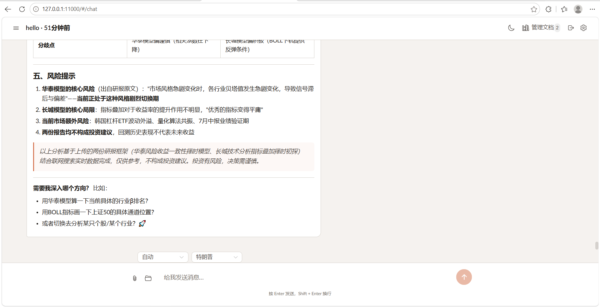
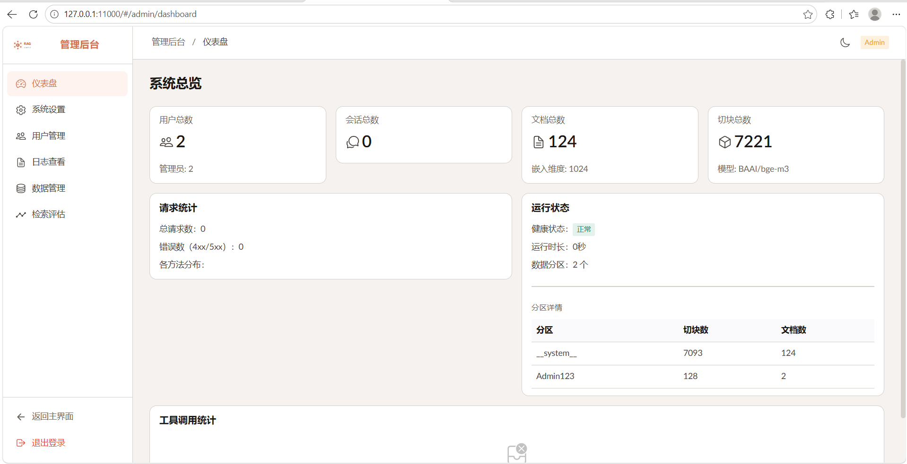

# AskFlow 

基于 FastAPI + LLM 的 RAG 知识问答系统。**前后端分离**、**端口化/适配器架构**
（本地实现与 Docker 服务可一行切换），支持多工作流、工具调用、PDF 解析、向量检索与容器化部署。

[]()
[]()
[]()
[]()

---

## 快速启动

### 前置条件

- Python 3.11+
- Node.js 18+
- MinerU API Key（PDF 解析）
- LLM API Key（对话 + 嵌入）
- Docker（可选，用于容器化基础设施/部署）

### 1. 安装后端

```bash
cd backend
# 使用 uv（推荐）
uv sync

# 或 pip（从 pyproject.toml 安装）
pip install -e .
```

### 2. 配置

配置以环境变量为主（12-factor）：在 `backend/` 下复制 `.env.example` 为 `.env` 后填入必要配置，
也可通过系统环境变量或 `docker compose` 注入覆盖。

```bash
cd backend
# 首次部署：复制模板并填入配置
cp .env.example .env

# 最小配置需要：
#   LLM_API_KEY / LLM_BASE_URL / LLM_MODEL
#   EMBED_API_KEY / EMBED_BASE_URL / EMBED_MODEL
#   MINERU_API_KEY（PDF 解析）
#
# 完整配置项参见 .env.example（各段均有注释）
```

参见 [backend/.env.example](backend/.env.example) 各段注释。

### 3. 启动服务

```bash
cd backend
python app.py
# 服务启动于 http://0.0.0.0:11000
```

> **可选**：基础设施与后端支持 Docker 化部署（见下方「6. Docker 部署」）。
> 默认不依赖任何容器；`.env` 中的开关按需切换。

### 4. 构建前端（可选，也可使用开发模式）

```bash
cd frontend
npm install
npm run build        # 生产构建 → frontend/dist/
# 或 npm run dev     # 开发模式 localhost:5173
```

构建后的 `frontend/dist/` 会自动被 FastAPI 作为静态文件服务。

### 5. 访问

- **对话界面**：`http://localhost:11000` —— 普通用户登录后进入
- **管理后台**：`http://localhost:11000/#/admin` —— 管理员登录后进入
  - 管理员账号由 `.env` 的 `AUTH_SUPERUSER_USERS` 配置，默认 `Admin123 / Admin123`

> **界面按角色隔离**：登录后自动按角色进入对应界面——管理员仅进管理后台、普通用户仅进对话界面，
> 手动访问另一侧会被路由守卫拦回（详见「主要功能」）。

### 6. Docker 部署（可选）

```bash
# 开发：只起基础设施，后端本地运行（cd backend && python app.py）
cd docker && docker compose up -d

# 生产：基础设施 + 后端容器一键启动
cd docker && docker compose --profile prod up -d --build
# 访问 http://localhost:11000
```

详见 `docker/docker-compose.yml`。

---

## 效果图

| 对话页 | 管理后台 |
|---|---|
|  |  |

---

## 项目架构

> **分层 + 适配器**结构。

```
askflow/
│
├── backend/                      # Python 后端（运行根，`cd backend && python app.py`）
│   ├── app.py                    #   入口（含启动装配 / 生命周期）
│   ├── core/                     #   共享内核（models/errors/dto/deps/exceptions/compositor）
│   ├── modules/                  #   业务模块（每个含 entity/dto/vo/service/controller）
│   │                             #   auth/user/session/history/document/query/config/dashboard/health/qa
│   ├── infra/                    #   基础设施（logger/llm_client/health/adapters[通用仓储+各适配器]）
│   ├── config/                   #   配置层（AppConfig / loader / facade[conf] / admin / env_aliases）
│   ├── agent/                    #   Agent 引擎（ToolLoop+14 工具）
│   ├── prompts/  tests/          #   提示词模板 / 测试基座
│   ├── data/                     #   运行时数据（向量库 / 日志 / 上传）
│   └── .env  .env.example  pyproject.toml
│
├── frontend/                     # Vue 3 前端（`cd frontend && npm run build`）
│   ├── src/  vite.config.js
│   └── dist/                     #   构建产物（由 FastAPI 托管）
│
├── docker/
│   ├── docker-compose.yml        # 基础设施编排（MySQL/Redis/RabbitMQ/MinIO/Milvus/backend）
│   │                             # 注：建库/建表由镜像环境变量 + SQLAlchemy create_all 完成，无 init.sql
│   └── data/                     # 各服务数据卷（bind mount，运行时生成）
├── assets/                       # 资源文件
└── README.md  LICENSE
```

## 核心数据流

```
用户输入
  │
  ├─ 历史加载 → 超限自动压缩/截断 (governor)
  │
  ├─ 组装 system + history + query
  │
  ├─ LLM 工具循环 (ToolLoop)
  │   ├─ LLM 决定调工具 → 并发执行 → 结果回灌 → 继续
  │   └─ LLM 决定直接回答 → 返回最终答案
  │
  ├─ should_continue 检查
  │   ├─ 超迭代上限? → 保存状态, "继续"恢复
  │   └─ 超上下文窗口? → 中断
  │
  └─ 保存历史 → 返回答案
```

## 主要功能

| 功能 | 说明 |
|------|------|
| **前后端分离** | Vue 3 前端（`frontend/`）+ FastAPI 后端（`backend/`），独立构建与部署 |
| **界面角色隔离** | 管理员仅进管理后台、普通用户仅进对话界面（路由守卫强制，无互跳入口） |
| **可替换后端** | 存储/向量/对象/队列/缓存 五个开关，本地实现（JSON/FAISS/磁盘/线程池）与 Docker 服务（MySQL/Milvus/MinIO/RabbitMQ/Redis）一行切换 |
| **容器化部署** | docker-compose 编排基础设施；生产 `--profile prod` 可连后端一起容器化 |
| **多工作流** | 简报、对比、深度研究、自动规划、美股分析（中文名取自 md 前置元数据） |
| **工具调用** | 14 个工具，知识库检索(RRF融合) + 联网搜索 + 文档阅读 |
| **PDF 解析** | MinerU API (VLM/Lite)，自动提取文本/表格/图片 |
| **多风格回答** | 巴菲特、马斯克、Jobs 等 6 种回答风格（中文名取自 SKILL.md 前置元数据） |
| **上下文治理** | 超预算自动压缩工具结果或截断旧历史 |
| **中断恢复** | 达工具上限后保存状态，"继续"即恢复 |
| **管理后台** | 配置热更新、用户管理（向量库/日志改用中间件自带控制台） |
| **图片安全** | 图片资源强制 JWT 鉴权，前端自动注入 token |

---


## 配置说明

配置**分层加载**（后者覆盖前者）：

1. `backend/.env.default` —— **默认配置**（完整默认值基线，随项目提供，程序启动时读取）
2. `backend/.env` —— **用户覆盖**（只需填写要修改的项；可从 `.env.example` 复制）
3. **系统环境变量** —— 最高优先级（Docker / CI 注入）

完整默认值见 [backend/.env.default](backend/.env.default)。关键配置（在 `.env` 中覆盖）：

```env
LLM_API_KEY=sk-...              # 对话模型 API Key
LLM_BASE_URL=https://...       # 对话模型地址
LLM_MODEL=deepseek-v4-...

EMBED_API_KEY=sk-...   # 嵌入模型 API Key
EMBED_BASE_URL=https://...
EMBED_MODEL=BAAI/bge-m3
EMBED_DIM=1024

MINERU_API_KEY=eyJ...             # PDF 解析 API Key
```

## 许可证

MIT
